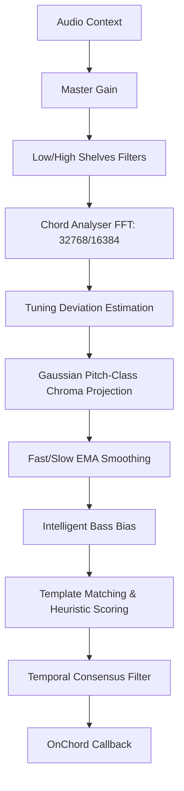

# Architecture Decision Record (ADR) - Chord Detection Engine Heuristics

## Status
Accepted

## Context
The Cadence Player provides real-time chord detection on local audio and video files during playback. To achieve smooth, accurate, and responsive chord labels, the DSP pipeline utilizes high-resolution spectral extraction combined with template matching and temporal consensus algorithms. 

This document captures the mathematical models, heuristic design, and multi-mode constraints of the `ChordDetector` engine to preserve stability and mitigate maintainer bus-factor.

---

## 1. Digital Signal Processing (DSP) Pipeline

The real-time audio signal is processed through a multi-stage DSP pipeline to extract a normalized 12-dimensional chroma vector (pitch-class energy map):

### 1.1 Spectral Analysis & Gating
* **FFT Size:** The engine defaults to an FFT size of $32768$ (or $16384$ fallback) to provide a high frequency resolution ($\approx 1.35\text{ Hz}$ per bin at $44.1\text{ kHz}$ sample rate). This resolution is essential to separate fundamental tones in lower registers.
* **RMS Gate:** Quiet or silent passages are ignored when the root-mean-square (RMS) level drops below `rmsGate` (default: `0.01` or `0.015`), preventing the analysis of ambient noise.

### 1.2 Tuning Estimation & Deviation Correction
To accommodate detuned recordings (or non-A440hz standard tunings), the engine periodically calculates a median tuning deviation in cents:
$$\text{midi} = 69 + 12 \log_2\left(\frac{f}{\text{tuningHz}}\right)$$
* Local spectral peaks in the range of $[100\text{ Hz}, 2000\text{ Hz}]$ are converted to MIDI values.
* The cents residuals relative to the nearest integer MIDI notes are calculated.
* The median of these residuals represents the tuning drift, which is smoothly blended into the internal reference frequency `tuningHz` (using a $0.3$ alpha smoothing factor).

### 1.3 Gaussian Chroma Projection
Individual frequency bins are mapped to the 12 pitch classes (C through B) using a Gaussian weighting function to handle spectral leakage and tuning drift:
$$w_{i, c} = \exp\left(-\frac{\Delta\text{cents}^2}{2\sigma^2}\right)$$
* Where $\Delta\text{cents}$ is the distance in cents between the bin frequency and the target pitch class, and $\sigma$ (`chromaSigmaCents`, default: `35`) represents the Gaussian distribution width.
* A frequency weighting curve is applied to boost lower-register fundamentals while rolling off high-register overtones:
  $$f_{\text{weight}}(f) = \begin{cases} 
    1.2 & f \le 100\text{ Hz} \\ 
    1.1 & 100 < f \le 200\text{ Hz} \\
    1.0 & 200 < f \le 400\text{ Hz} \\
    \exp\left(-\frac{f-1600}{1000}\right) \cdot 0.8 & f > 1600\text{ Hz}
  \end{cases}$$

---

## 2. Heuristic Scoring & Template Matching

### 2.1 Scoring Formula
For each of the 12 possible root keys, the projected chroma vector is compared against a set of enhanced chord templates. The ultimate template score is a weighted combination of four distinct scoring metrics:
$$\text{Score} = 0.34 \cdot D_{\text{dot}} + 0.34 \cdot C_{\text{cos}} + 0.16 \cdot H_{\text{harmonic}} + 0.16 \cdot R_{\text{root\_support}}$$

1. **Dot Product ($D_{\text{dot}}$):** Simple linear energy match: $\sum \text{chroma}_i \cdot \text{template}_i$.
2. **Cosine Similarity ($C_{\text{cos}}$):** Measures directional alignment of normalized vectors, penalizing broad noise.
3. **Harmonic Score ($H_{\text{harmonic}}$):** Validates the presence of expected harmonics (Root, 5th, 3rd, 7th, 9th) relative to the template weights.
4. **Root Support ($R_{\text{root\_support}}$):** Ensures critical intervals (like thirds and fifths) are strongly defined, with dedicated exclusions for suspended or power chords.

### 2.2 Intelligent Bass Bias
To identify chord inversions and stabilize root detection, energy in the bass region ($80\text{ Hz}$ to $250\text{ Hz}$) is isolated. 
* The dominant bass pitch class is smoothed via an exponential moving average.
* If the bass energy exceeds $0.3$, a bias factor (`bassBias`, default: `0.15`) is added to that pitch class in the chroma vector before final template scoring.

### 2.3 Extension & Inversion Promotion
* **Advanced Extensions:** If the dominant triad template passes confidence rules, the engine analyzes higher-register intervals (6ths, major/dominant 7ths, 9ths, 11ths, and 13ths) to promote basic triads to their advanced counterparts (e.g. `C` promoted to `CMaj9` or `Cm7♭5`).
* **Inversions:** If the strongest bass frequency corresponds to a valid chord tone (third or fifth) rather than the root, and the bass energy exceeds the root energy by $1.3\times$, the chord is promoted as an inversion (e.g. `C/E` or `G/D`).

---

## 3. Temporal Smoothing & State Machine

To prevent chord "flicker" during note transitions or percussion hits, the engine implements a robust debounce state machine:

### 3.1 Dual-EMA Smoothing
The chroma vector is tracked in parallel through two exponential moving averages:
* **Fast EMA ($\alpha = 0.4$):** Captures quick transitions.
* **Slow EMA ($\alpha = 0.15$):** Retains temporal stability.
* The final chroma vector is a dynamic blend of Fast and Slow EMAs, adjusted based on signal stability metrics.

### 3.2 Consensus Filter
The last $8$ frame detections are kept in a rolling queue.
* Detections in the last 5 frames are counted with age-based exponential decay weights.
* A consensus detection is selected if it appears consistently and holds a weighted frequency count $\ge 1.5$. This filters out short spurious transients.

### 3.3 Hold & Stability Timers
* **Adaptive Stable Frames:** Detections with higher confidence require fewer consecutive stable frames (e.g. 1 frame) to enter, while lower-confidence candidates require more (up to `requiredStableFrames`).
* **Hold Timers:**
  * **Enter Hold (`holdMsEnter`, default: `300` - `500\text{ ms}`):** Minimum time a new chord must remain stable before transitioning.
  * **Exit Hold (`holdMsExit`, default: `250` - `400\text{ ms}`):** Minimum time a chord must remain silent or low-confidence before the display reverts to the default empty state (`—`).

---

## 4. Multi-Mode Performance Presets

The application supports four operational presets to balance CPU consumption and detection fidelity:

| Preset Mode | FFT Size | Smoothing Constants (Fast/Slow) | Stability Window (Frames) | Gating Thresholds | Best Suited For |
| :--- | :--- | :--- | :--- | :--- | :--- |
| **lowcpu** | 8192 | 0.45 / 0.20 | 2 | Low | Under-powered or virtualized systems |
| **normal** | 16384 | 0.40 / 0.15 | 3 | Medium | General listening / standard desktop CPU |
| **accurate** | 32768 | 0.32 / 0.12 | 4 | High | Complex jazz/classical, stable pitch locking |
| **responsive**| 16384 | 0.50 / 0.25 | 1 | Low | Live performance, rapid tempo tracking |
